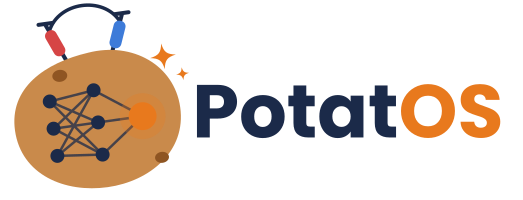

<p align="center">
  
</p>

# potatOS

中文 · [English](README-en.md)

potatOS 是一个用 Go 编写的 agent core SDK，也是 Aperture 系列 agent 中最小的模块。Aperture 系列的名字来自游戏《传送门》中的光圈科技（Aperture Science），potatOS 则取自《传送门 2》里被装进土豆电池的 GLaDOS：只留下最核心的部分，靠一颗土豆也照样能运转。

agent 指的是由大模型驱动、能够自己调用工具完成任务的程序，你可以用 potatOS 在自己的程序里构建这样的 agent。

SDK 本身只负责三件事：调用模型、运行 agent 循环、管理上下文。其余部分都以注册的方式交给你，包括工具、后台任务、斜杠命令、hook、审查规则、skills、长期记忆、可以调用的其他 agent 以及存储。运行过程中发生的每一件事都会以事件的形式发出，你的程序订阅这些事件，就能把过程展示给用户或者记录下来。potatOS 以库的形式嵌入你的程序，不是独立运行的服务，也不带界面。

## 功能

- 三种模型接口：Anthropic Messages、OpenAI Chat Completions 和 OpenAI Responses。其中 Chat Completions 适配器也兼容 DeepSeek、Qwen、vLLM、Ollama、OpenRouter、LiteLLM 等服务。
- agent 循环，包括输入队列、并行执行工具、重试、打断和事件流。
- 上下文管理，包括固定结构的系统提示词、自动压缩、回退、分叉、旁路对话和历史检索。
- hook、审查规则与审查者，以及后台任务的协议。
- 内置扩展，包括 subagent、skills、memory、A2A 客户端、MCP 客户端、斜杠命令和费用查询。
- JSONL 存储、会话恢复和会话标签。
- 只依赖 Go 标准库，唯一的例外是 MCP 客户端 `ext/mcp`，它使用官方 MCP Go SDK 以及 `golang.org/x/oauth2` 和 `jsonschema-go`。不依赖任何模型厂商的 SDK。

## 安装

```bash
go get github.com/estonshi/aperture-potatos
```

potatOS 要求 Go 1.25 及以上版本。

## 示例

下面的程序注册了一个工具，并把模型的回答以流式方式打印出来。

```go
package main

import (
	"context"
	"encoding/json"
	"fmt"
	"log"
	"os"

	"github.com/estonshi/aperture-potatos/event"
	"github.com/estonshi/aperture-potatos/kernel"
	"github.com/estonshi/aperture-potatos/provider"
	"github.com/estonshi/aperture-potatos/provider/anthropic"
	"github.com/estonshi/aperture-potatos/std"
)

type weatherIn struct {
	City string `json:"city"`
}

func main() {
	ctx := context.Background()
	claude := anthropic.New(anthropic.Config{APIKey: os.Getenv("ANTHROPIC_API_KEY")})

	// 模型可以调用的工具，输入按 json tag 解码到 weatherIn
	weather := kernel.NewTool(kernel.ToolSpec{
		Name:        "get_weather",
		Description: "Current weather of a city.",
		InputSchema: json.RawMessage(`{"type":"object","properties":{"city":{"type":"string"}},"required":["city"]}`),
	}, func(ctx context.Context, tc *kernel.ToolContext, in weatherIn) (kernel.ToolResult, error) {
		return kernel.TextResult(in.City + ": sunny, 22°C"), nil
	})

	ag, err := kernel.New(
		std.Defaults(), // 默认扩展：压缩、历史检索、任务管理工具、subagent 和内置命令
		kernel.WithModel(provider.ModelRef{Provider: claude, Model: "claude-sonnet-5-5"}),
		kernel.WithTool(weather),
	)
	if err != nil {
		log.Fatal(err)
	}
	defer ag.Close(ctx)

	sess, err := ag.NewSession(ctx)
	if err != nil {
		log.Fatal(err)
	}
	defer sess.Close(ctx)

	// Run 发送一条输入，并产出这一轮的全部事件，直到 turn.completed
	for ev, err := range sess.Run(ctx, kernel.Text("东京天气怎么样？")) {
		if err != nil {
			log.Fatal(err)
		}
		switch d := ev.Data.(type) {
		case *event.MessageDelta:
			fmt.Print(d.Text)
		case *event.TurnCompleted:
			fmt.Printf("\n[turn %s, %d steps]\n", d.Outcome, d.Steps)
		}
	}
}
```

带审查和存储的完整示例见[快速开始](document/developer-guide/02-quickstart.md)。

## 文档

- [开发指南](document/developer-guide/README.md)：逐项介绍各个功能，附示例和建议做法，可以从[简介](document/developer-guide/01-overview.md)开始阅读。
- [架构说明](document/architecture.html)：SDK 内部是如何组织起来的。
- [发布说明](document/releases/v0.3.0.md)：v0.3.0 的新增、行为变更与迁移。
- 规范：`spec/` 目录下是与语言无关的规范，定义事件、会话文件格式、面向模型的文字和默认值，`conformance/` 目录下是对应的一致性测试用例。本 Go 实现支持 spec 0.3，即 `v0.3.y` 各版本，详见[支持的 spec 版本](document/developer-guide/01-overview.md#支持的-spec-版本)。

## 目录结构

| 目录 | 内容 |
|---|---|
| `kernel` | Agent、Session 以及全部公开 API，包括工具、hook、任务、命令和上下文管理。 |
| `provider` | 模型引用、参数、能力声明、重试，以及三种接口的适配器。 |
| `ext`、`std` | 各个扩展，以及一行代码装配默认扩展的 `std`。 |
| `event`、`message`、`store` | 事件、消息，以及存储接口和它的内存实现、JSONL 实现。 |
| `spec`、`conformance` | 与语言无关的规范及其一致性测试用例。 |
| `document` | 开发指南和架构说明，有中文版和英文版（`document/en`）。 |

## 许可证

potatOS 以 [MIT 许可证](LICENSE)发布，`spec/` 与 `conformance/` 也适用同一许可证。
