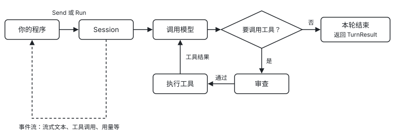

[目录](README.md) · [下一章：快速开始 →](02-quickstart.md)

# 1. 简介

本章介绍 potatOS 是什么、适合用来做什么，以及它和你的程序之间如何分工，然后说明安装方法和常用的包。

本章内容：[1.1 potatOS 是什么](#11-potatos-是什么) · [1.2 适用场景](#12-适用场景) · [1.3 功能与分工](#13-功能与分工) · [1.4 安装](#14-安装) · [1.5 常用的包](#15-常用的包) · [1.6 运行流程概览](#16-运行流程概览)

## 1.1 potatOS 是什么

potatOS 是一个用 Go 编写的 agent core SDK，用来在你自己的程序里构建 agent。

这里的 agent 指的是由大模型驱动、能够自己调用工具完成任务的程序。它的核心是一个循环：程序把用户的输入交给模型，模型如果决定调用工具，程序就执行这些工具并把结果交还给模型，模型再决定下一步，直到给出最终回答。在这个循环之外，一个可用的 agent 还要处理很多事情，例如流式输出、并行执行工具、出错重试、在模型工作时接收新的输入、在危险操作前请人确认、在对话过长时压缩上下文，以及在进程重启后恢复对话。

potatOS 实现的就是这一部分。它本身只负责三件事：调用模型、运行 agent 循环、管理上下文。其余可以定制的部分都以注册的方式开放给你，包括 agent 的昵称、系统提示词中的指令、工具、后台任务、斜杠命令、hook、审查规则、skills、长期记忆、可以调用的其他 agent 以及存储。运行过程中发生的每一件事都会以事件的形式发出，你的程序订阅这些事件，就能把过程展示给用户或者记录下来。

potatOS 以库的形式嵌入你的程序，不是一个独立运行的服务，也不带界面。你在代码中创建 agent、发送输入、订阅事件，至于 agent 以命令行工具、Web 服务还是后台程序的形式提供给用户，由你的程序决定。

## 1.2 适用场景

如果你要开发的产品需要一个能调用工具的 agent，并且希望自己掌握界面、部署方式和业务逻辑，就适合使用 potatOS。例如带工具的对话助手、在网页上运行并需要人工审批操作的业务 agent、在后台批量处理任务的 agent，或者需要把工作分派给 subagent 和其他 agent 的系统。

potatOS 关注的是 agent 如何思考和行动，不负责 agent 如何被部署和访问。如果你需要的是一个开箱即用的聊天产品，或者只想单次调用模型而不需要工具和多轮循环，直接使用模型厂商的接口会更简单。

## 1.3 功能与分工

SDK 为你提供以下能力：

- 三种模型接口：Anthropic Messages、OpenAI Chat Completions 和 OpenAI Responses。其中 Chat Completions 接口兼容 DeepSeek、Qwen、vLLM、Ollama、OpenRouter、LiteLLM 等服务。
- agent 循环，包括输入队列、并行工具、重试、打断和事件流。
- 上下文管理，包括固定结构的系统提示词、自动压缩、回退、分叉和历史检索。
- hook、审查规则与审查者，以及任务（后台工作）协议。
- 内置扩展，包括 subagent、skills、memory、A2A 客户端、MCP 客户端、斜杠命令和费用查询。
- JSONL 存储与会话恢复。

以下部分需要你自己负责：

- UI、CLI 或 HTTP 服务。
- 鉴权与多租户。
- 模型配置。SDK 不内置模型表，上下文窗口、输出上限等能力由你声明，或在运行时查询。
- 审查者的界面，它可以是终端、网页或其他服务。
- A2A 服务端。
- 生产环境使用的存储后端。你只需实现一个接口即可接入。

SDK 只依赖标准库，唯一的例外是 MCP 客户端 `ext/mcp`，它使用官方 MCP Go SDK 以及 `golang.org/x/oauth2` 和 `jsonschema-go`。它不依赖任何模型厂商的官方 SDK，也不假设宿主机上有 shell 或文件系统。所有提供给模型的内置文字都使用英文和中性措辞，不包含产品名。

## 1.4 安装

使用 `go get` 安装：

```bash
go get github.com/estonshi/aperture-potatos
```

MCP 客户端 `ext/mcp` 也包含在这个 module 中，不需要另外安装。它依赖官方 MCP Go SDK 以及 `golang.org/x/oauth2` 和 `jsonschema-go`；程序不 import `ext/mcp` 时，这些库不会被编译进去。

> 注意：potatOS 要求 Go 1.25 及以上版本。

### 支持的 spec 版本

potatOS 的事件、会话文件格式、提示词文本和默认值由仓库 `spec/` 目录下与语言无关的规范定义，其他语言的实现遵循同一份规范。规范按 SemVer 编号，当前版本写在 `spec/VERSION` 中，变更记录见 `spec/CHANGELOG.md`。

本 Go 实现支持 spec 0.3，由 `v0.3.y` 各 SDK 版本提供。spec 只发 `MAJOR.MINOR`，不发 PATCH；SDK 是 `vMAJOR.MINOR.PATCH`，`v0.3.y` 都满足 spec 0.3。

- 新建的会话在 `session.started` 事件的 `spec_version` 字段和会话文件第一行中记录 `0.3`，写出的数据只包含 spec 0.3 定义的字段。
- 恢复会话时按行格式版本 `v` 判断能否读取，与第一行记录的 spec 版本无关。`v` 为 1 的会话文件都可以读取，包括其他语言实现写出的；`v` 更高时返回 `store.ErrIncompatibleStore`。
- 读取较新版本写出的数据时，不认识的字段会被忽略，不认识的内容块保留为 `*message.OpaqueBlock`，不认识的事件类型解码为 `*event.Unknown`。

## 1.5 常用的包

下表列出了开发中最常用的包。表中的 `...` 代表 module 路径 `github.com/estonshi/aperture-potatos`。

| import 路径 | 用途 | 主要相关章节 |
|---|---|---|
| `.../kernel` | 提供 Agent、Session、工具、hook、任务、命令等全部公开 API。 | 全部 |
| `.../std` | 用一行代码装配默认扩展。 | [13.4](13-extensions.md#134-使用-std-安装默认扩展) |
| `.../provider` | 提供模型引用、参数、能力声明、重试策略和错误分类。 | [4](04-models.md) |
| `.../provider/anthropic`、`.../provider/openaichat`、`.../provider/openairesponses` | 三种模型接口各自的适配器。 | [4.1](04-models.md#41-三种适配器) |
| `.../provider/providertest` | 提供测试用的脚本 provider 和 HTTP 回放。 | [21](21-testing.md) |
| `.../message` | 定义消息、内容块、用量和 Pin。 | [6](06-events.md)、[16](16-storage.md) |
| `.../event` | 定义事件信封和各类事件负载。 | [6](06-events.md) |
| `.../store`、`.../store/jsonl` | 提供存储接口、内存实现和 JSONL 实现。 | [16](16-storage.md) |
| `.../ext/compact`、`.../ext/history`、`.../ext/tasks`、`.../ext/subagent` | 默认装配的扩展。 | [14](14-builtin-extensions.md) |
| `.../ext/skills`、`.../ext/memory`、`.../ext/peer`、`.../ext/peer/a2a`、`.../ext/mcp` | 需要配置后才装配的扩展。 | [14](14-builtin-extensions.md) |
| `.../ext/cmd/<name>cmd` | 七个内置斜杠命令，每个命令一个包。 | [10.5](10-commands.md#105-内置命令) |
| `.../ext/litellm` | 经 LiteLLM 网关调用模型时，提供请求打标和费用查询。 | [17](17-usage-cost.md) |

## 1.6 运行流程概览

`Agent` 是一份配置，一个 Agent 可以创建多个 `Session`，每个 Session 代表一段对话。你向 Session 发送输入后，它在后台完成一轮（turn）处理。在这个过程中，Session 会持续发出事件，例如流式文本、工具调用和用量，并在本轮结束时返回结果。

下图展示了一轮处理的流程：



流程中的每个环节都有对应的章节。发送输入见第 [5](05-input.md) 章，事件见第 [6](06-events.md) 章，模型见第 [4](04-models.md) 章，工具见第 [7](07-tools.md) 章，审查见第 [8](08-approval.md) 章。如果你想在任意环节介入处理，请阅读第 [9](09-hooks.md) 章。

---

[目录](README.md) · [下一章：快速开始 →](02-quickstart.md)
