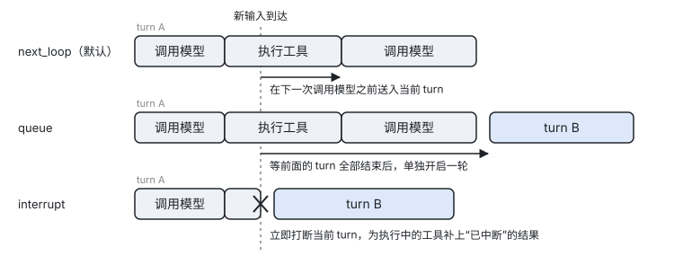

[← 上一章：接入模型](04-models.md) · [目录](README.md) · [下一章：订阅事件 →](06-events.md)

# 5. 发送输入与等待结果

本章介绍如何把用户的话、命令或宿主的提示交给 agent，并获取这一轮的结果。本章还会说明 agent 正忙时新输入何时送达、如何打断正在运行的 turn，以及把 SDK 接入 CLI 和 Web 服务的常见写法。

本章内容：[5.1 三种发送方式](#51-三种发送方式) · [5.2 输入的内容与发送选项](#52-输入的内容与发送选项) · [5.3 回执](#53-回执) · [5.4 agent 正忙时的三种模式](#54-agent-正忙时的三种模式) · [5.5 发送不唤醒 agent 的提醒](#55-发送不唤醒-agent-的提醒) · [5.6 打断](#56-打断) · [5.7 撤回与立即发送排队中的输入](#57-撤回与立即发送排队中的输入) · [5.8 TurnResult](#58-turnresult) · [5.9 输入相关的事件](#59-输入相关的事件) · [5.10 常见集成方式](#510-常见集成方式) · [5.11 建议做法](#511-建议做法)

## 5.1 三种发送方式

session 提供三种发送输入的方式。`Send` 立即返回一个回执，你可以稍后再等待结果。`Run` 发送输入并迭代这一轮产生的事件。`Command` 直接执行一条命令，不经过文本解析：

```go
// 1. Send：立即返回回执，之后再等待结果
rcpt, err := sess.Send(kernel.Text("帮我订酒店"))
res, err := rcpt.Wait(ctx) // TurnResult

// 2. Run：发送并迭代这一轮的事件，直到 turn.completed
for ev, err := range sess.Run(ctx, kernel.Text("继续")) { ... }

// 3. Command：直接执行一条命令，不经过文本解析
rcpt, err = sess.Command("compact", "保留预算相关的结论")
```

`Send` 收到的文本如果来源为 human、以 `/` 开头，并且后面是已注册的命令名或别名，就会被当作命令执行。如果 `/` 后面不是已注册的名字，文本会作为普通内容发给模型。以 `//` 开头表示字面意义上的斜杠。你可以用 `kernel.NoCommandParsing()` 关闭这种解析。

在 `Run` 中途 break 或取消 ctx，只会停止迭代，不会停止这一轮。如果发送的是命令，`Run` 会持续产出该命令的事件，直到 `command.completed`。

如果你想等待整个 session 都安静下来，可以使用 `sess.WaitQuiet(ctx)`。安静是指 turn 已经结束、排队的命令已经执行完、后台任务已经结束，并且任务通知也已经发出。`WaitQuiet` 返回最后一轮的 `TurnResult`。

## 5.2 输入的内容与发送选项

一条输入由 `kernel.Input` 描述，除了文本之外，还可以携带图片或文档、来源信息和自定义元数据：

```go
kernel.Input{
	Text:     "看看这张图",
	Parts:    message.Content{&message.ImageBlock{MediaType: "image/png", Data: png}}, // 图片或文档
	Origin:   message.Origin{Kind: message.OriginHuman},                                // 默认为 human
	Metadata: map[string]string{"request_id": "r-1"},                                  // kernel 不解读，工具中通过 tc.InputMetadata() 读取
}
```

`kernel.Text(s)` 是只包含文本的输入的简写。`Parts` 中可以放入 `*message.ImageBlock` 和 `*message.DocumentBlock`。`ImageBlock` 需要设置 `MediaType`，以及 `Data` 或 `URL` 之一。`DocumentBlock` 除此之外还有 `Filename` 字段。

`Origin.Kind` 只接受四种取值：`human` 表示用户说的话，`command` 表示由命令展开的内容，`agent` 表示另一个 agent 发来的消息，`reminder` 表示运行时提醒。其他取值会返回 `ErrInvalidOrigin`。`Origin.Source` 是自由文本标签，例如 `"app:prefs"` 或 `"hook:audit"`，模型和 hook 都能看到它。

`Send` 和 `Run` 都接受以下发送选项：

| 选项 | 作用 |
|---|---|
| `kernel.WithMode(m)` | 设置这一条输入的忙时模式，详见 [5.4](#54-agent-正忙时的三种模式)。 |
| `kernel.WithOrigin(o)` | 效果与设置 `Input.Origin` 相同。 |
| `kernel.WithMetadata(md)` | 效果与设置 `Input.Metadata` 相同。 |
| `kernel.NoWake()` | 不因为这条输入开启新一轮，它会在下一次模型调用或下一轮时一起送达。 |
| `kernel.NoCommandParsing()` | 以 `/` 开头的文本也按普通输入处理。 |

## 5.3 回执

`Send` 和 `Command` 返回 `*kernel.Receipt`，你可以通过它等待结果或获取输入的 id。回执提供以下方法：

| 方法 | 说明 |
|---|---|
| `Wait(ctx) (TurnResult, error)` | 等待这条输入所在的 turn 结束，如果是命令则等待命令结束。只有等待本身失败时才返回 error，例如 ctx 被取消或 session 已关闭。turn 以何种方式结束，请查看 `TurnResult`。 |
| `Done() <-chan struct{}` | 在结束时关闭，可以放进 select 中使用。 |
| `InputID() string` | 返回这条输入的 id，与事件中的 `input_id` 相对应。 |

一条输入可能与其他输入合并进同一轮，具体规则见下一节。这种情况下，它们的回执会返回同一个 `TurnResult`。

## 5.4 agent 正忙时的三种模式

当 agent 正在处理一轮时，新到达的输入如何送达由忙时模式决定。SDK 提供三种模式：

| 模式 | 行为 |
|---|---|
| `kernel.ModeNextLoop`（默认） | 在当前这批工具执行完、下一次调用模型之前，送进当前 turn。如果这一轮已经结束，则成为下一轮的输入。 |
| `kernel.ModeQueue` | 等前面的 turn 全部结束后，单独开启一轮。 |
| `kernel.ModeInterrupt` | 立即打断当前 turn，并为正在执行的工具补上“已中断”的结果，然后马上处理这条输入。 |

下图展示了同一条新输入在三种模式下的送达时机：



发送时通过 `kernel.WithMode` 指定模式：

```go
sess.Send(kernel.Text("改成大阪"), kernel.WithMode(kernel.ModeInterrupt))
```

默认模式可以通过 `kernel.WithInputMode` 在 agent 级修改，也可以通过 `kernel.SessionInputMode` 在 session 级修改。排在队列中的命令会起到屏障的作用，在它之后到达的输入一定会等它执行完才送达。

三种模式适用于不同的场景。如果用户在模型工作时补充一句“顺便也查下大阪”，适合使用默认的 `next_loop`，模型在下一步就能看到这句话。如果用户点击“停止，重来”，适合使用 `interrupt`。如果是系统批量灌入的后续问题，适合使用 `queue`。

## 5.5 发送不唤醒 agent 的提醒

有时宿主需要向模型补充一条背景信息，但不希望因此触发模型作答。这时可以发送一条 reminder，并加上 `NoWake` 选项：

```go
prefs := message.Origin{Kind: message.OriginReminder, Source: "app:prefs"}
sess.Send(kernel.Input{Text: "The user prefers trains to flights.", Origin: prefs}, kernel.NoWake())
```

这条提醒会随下一轮或下一次模型调用一起送达。`sess.Announce(source, text, payload)` 的效果与此相同，同时还可以发出一个事件。`ag.Announce` 则会向这个 agent 所有打开的 session 各发一条提醒。

提醒在送给模型时会带有标签。系统提示词中已经告诉模型，提醒不是用户说的话，也不代表用户的授权。

## 5.6 打断

当你需要停止正在运行的 turn 时，可以使用以下三个方法：

| 方法 | 效果 |
|---|---|
| `sess.Interrupt(reason)` | 打断正在运行的 turn，后台任务照常运行。这一轮已经取走、但还没写进历史的 human、command 和 agent 输入会被丢弃，并发出 `input.dropped{interrupted}`。中途补进来的输入会退回队列。 |
| `sess.InterruptAndDrop(reason)` | 打断 turn，并丢弃队列中的 human、command 和 agent 输入，reminder 会保留。 |
| `sess.InterruptTurn(turnID, reason)` | 只打断指定的那一轮。如果你在等待某一轮时想停止它，请使用这个方法，这样可以避免在它刚结束、下一轮刚开始时误停了下一轮。 |

三个方法都会立即返回，返回值表示调用时是否有可以打断的 turn。

打断按以下顺序进行：

1. SDK 先发出 `turn.interrupt_requested` 事件，然后取消 turn 的 ctx。被打断的 turn 的 ctx 取消原因是 `*kernel.InterruptError{Reason}`。
2. 正在执行的工具有 `Limits.ToolCancelGrace` 的宽限时间用于退出，默认为 3s。超时仍未退出的调用记为放弃，并发出 `tool.abandoned`。
3. 历史中每个未完成的工具调用都会补上“已中断”的结果。
4. turn 以 `interrupted` 结束。

## 5.7 撤回与立即发送排队中的输入

agent 正忙时，用户发出的消息会先在队列中等待。如果用户改变了主意，你可以撤回还在排队的消息。如果用户希望某条消息马上得到处理，你可以把它改为打断，让 agent 停下当前这一轮、立即处理这条消息。这两种操作对 queue 和 next_loop 模式的消息都适用，用发送时得到的 input id 指定消息：

```go
rcpt, _ := sess.Send(kernel.Text("顺便查下大阪"), kernel.WithMode(kernel.ModeQueue))

// 用户点击“撤回”
err := sess.Withdraw(rcpt.InputID())

// 或者用户点击“立即发送”
err = sess.InterruptWith(rcpt.InputID())
```

`Withdraw` 把消息从队列中移除，模型不会看到它。SDK 会发出 `input.dropped` 事件，原因为 `withdrawn`。这条消息的回执随之结束，`TurnResult.Outcome` 为 `dropped`。

`InterruptWith` 的效果与这条消息一开始就用 `ModeInterrupt` 发送相同。正在运行的 turn 会立即被打断，`turn.interrupt_requested` 事件的 `Reason` 中会写明是哪条输入触发的。如果这一轮在此之前已经被要求打断，就不会再发出这个事件。被打断的那一轮已经取走、但还没写进历史的输入会回到队列，不会丢失。之后的送达顺序与平常相同：next_loop 模式的消息会和这条消息按到达顺序一起进入下一轮，queue 模式的消息仍然各自单独开一轮。如果这条消息是用 `NoWake` 发送的，改为打断后它同样会唤醒 session。

这两个方法只对还在队列中的消息有效。如果调用时消息已经被某一轮取走，方法会返回 `kernel.ErrNotQueued`，并且不做任何改动。被取走有两种情况：一是默认模式的消息在当前这批工具执行完时已经送进了当前这一轮，这时模型在下一次调用时就会看到它，不需要再做处理；二是消息正在作为新一轮的输入送达。以下情况同样会返回 `ErrNotQueued`：

- 消息已经被丢弃或撤回过，或者 id 不存在。
- id 指向的是排队中的命令，例如 agent 忙时输入的 `/compact`。
- 对任务通知调用 `Withdraw`。任务通知总会送达，不能撤回，但你可以在 `task_notify` hook 中改写它的文字，或者让它不唤醒 session。
- 对调用 `Unpin` 时 SDK 自动排入的提醒调用 `Withdraw`。这条提醒必须写进历史，否则恢复会话后被撤销的 Pin 会重新出现。

对任务通知和这条提醒调用 `InterruptWith` 是允许的。

`ErrNotQueued` 只说明调用的那一刻消息不在队列中，并不表示消息一定已经送达。取走它的那一轮如果在把它写进历史之前就被打断，这条消息有可能回到队列，之后仍然可以撤回或改为打断。

> 注意：队列中有等待执行的命令时，排在命令之后的消息改为打断后，仍然要等这条命令执行完才会送达。session 正在执行压缩之类的命令时，改为打断的消息会在命令结束后开始新的一轮。

两个方法会等 session 处理完这次请求再返回，但不会等待 turn 结束，因此也可以在工具、hook 和事件回调中调用。请求总是排在之前发送的输入之后处理，所以 `Withdraw` 不会抢在它要撤回的那条消息入队之前执行。不过，如果 session 正好空闲，消息可能在你调用 `Withdraw` 之前就已经开始了新的一轮，这时同样会返回 `ErrNotQueued`。

## 5.8 TurnResult

`Receipt.Wait` 返回 `kernel.TurnResult`，它描述了这一轮是如何结束的，以及这一轮的用量和最终文本。`TurnResult` 包含以下字段：

| 字段 | 说明 |
|---|---|
| `TurnID` | 这一轮的 id。 |
| `Outcome` | 这一轮的结局，取值见下表。 |
| `StopReason` | 模型最后一次调用的停止原因，例如 `end_turn`、`tool_use`、`max_tokens`、`refusal` 等。 |
| `Steps` | 这一轮调用模型的次数。 |
| `Usage` | 这一轮的用量合计。 |
| `FinalText` | 这一轮最后一段 assistant 文本，供只需要最终答案的调用方使用。 |
| `Command` | 当回执属于命令时，表示命令的结果，类型为 `*CommandResult`。 |
| `Err` | 结局为 `error` 时的错误。 |

`Outcome` 有以下取值：

| `Outcome` | 含义 |
|---|---|
| `completed` | 正常结束。 |
| `max_steps` | 达到了 `Limits.MaxSteps` 的限制。默认不限，只有设置了上限才会出现。 |
| `max_tokens` | 回复被输出上限截断。 |
| `refused` | 模型拒绝回答或被内容过滤，回复不会写进历史。 |
| `hook_stopped` | 被 hook 或审查者叫停。 |
| `interrupted` | 被打断。 |
| `error` | 遇到不可重试的错误，或重试次数已用尽。 |
| `canceled` | session 已关闭。 |
| `dropped` | 输入在被任何一轮使用之前就被丢弃，例如调用了 `InterruptAndDrop`，或被 hook 拦下。 |
| `command` | 回执属于命令。 |

无论以哪种结局结束，历史都是合法的。每个没有执行的工具调用都会补上结果，因此下一轮可以直接接着发送。

## 5.9 输入相关的事件

输入从被接受到送达、再到所在的 turn 结束，会依次产生以下事件：

| 事件 | 触发时机 | 主要字段 |
|---|---|---|
| `input.accepted` | `Send` 接受了这条输入。 | `InputID`、`Mode`、`Origin`、`Text`、`QueueLen` |
| `input.injected` | 输入送达了某个 turn 的某个 step。 | `InputIDs`、`TurnID`、`Step` |
| `input.dropped` | 输入被丢弃。 | `InputID`、`Reason` |
| `turn.started` | 一轮开始。 | `TurnID`、`Trigger`（`human`、`command`、`agent`、`task`、`reminder`）、`InputIDs` |
| `turn.interrupt_requested` | 有调用方要求打断。 | `TurnID`、`Reason` |
| `turn.completed` | 一轮结束。 | `TurnID`、`Outcome`、`StopReason`、`Steps`、`Usage`、`Error`、`DurationMs` |

## 5.10 常见集成方式

本节给出几种常见场景下的写法。

### 命令行程序

命令行程序通常每次读入一行，发送后流式打印这一轮的文本，等这一轮结束再读下一行：

```go
for {
	line := readLine()
	for ev, err := range sess.Run(ctx, kernel.Text(line)) {
		if err != nil {
			return err
		}
		if d, ok := ev.Data.(*event.MessageDelta); ok && len(ev.Path) == 0 {
			fmt.Print(d.Text)
		}
	}
	fmt.Println()
}
```

### Web 服务

Web 服务通常用一个长连接向前端推送事件，用另外的请求发送输入和打断：

```go
// GET /sessions/{id}/events：通过 SSE 长连接推送事件
sub, _ := sess.Subscribe(ch, kernel.WithTypes("message.", "tool.", "turn.", "approval.", "input."))
defer sub.Unsubscribe()
for ev := range ch {
	writeSSE(w, ev) // ev 可以直接 json.Marshal
}

// POST /sessions/{id}/messages：立即返回，不等待 turn 结束
rcpt, err := sess.Send(kernel.Text(body.Text), kernel.WithMetadata(map[string]string{"request_id": reqID}))
respond(w, map[string]string{"input_id": rcpt.InputID()})

// POST /sessions/{id}/interrupt
sess.Interrupt("user clicked stop")

// POST /sessions/{id}/messages/{input_id}/withdraw
if err := sess.Withdraw(inputID); errors.Is(err, kernel.ErrNotQueued) {
	respond(w, map[string]string{"status": "not_queued"}) // 已被取走、已撤回或 id 不存在
}

// POST /sessions/{id}/messages/{input_id}/send-now
err = sess.InterruptWith(inputID)
```

### 只获取最终答案

如果调用方只关心最终答案，不需要中间过程，可以发送后直接等待结果并读取 `FinalText`：

```go
rcpt, _ := sess.Send(kernel.Text(q))
res, err := rcpt.Wait(ctx)
answer := res.FinalText
```

## 5.11 建议做法

- UI 的“停止”按钮应调用 `Interrupt`，而不是 `Close`。调用 `Close` 之后 session 就无法再使用了。
- 用户在模型工作期间再次发言时，直接用默认模式调用 `Send` 即可。模型在下一步就能看到新输入，比打断后重来更节省 token。
- 建议把请求 id 放进 `Metadata`，并在工具中通过 `tc.InputMetadata()` 读取，以便做链路追踪。
- 程序性的后台信息应当用 reminder 加 `NoWake` 发送，不要把它伪装成用户的话。模型会区别对待这两类内容，审计日志也会更清晰。
- 界面可以为排队中的消息提供“撤回”和“立即发送”两个按钮。收到 `input.injected`、包含这条消息 id 的 `turn.started` 或 `input.dropped` 之后，就把消息标记为已送达或已撤回。按钮调用返回 `ErrNotQueued` 时，说明消息此刻不在队列中，可以先把按钮置灰，再根据后续事件确定它是已送达还是回到了队列。
- 如果 `Send` 返回 `ErrQueueFull`，提示用户稍等即可，不要反复重试。队列上限为 256，由 `Limits.MaxQueuedInputs` 控制。
- 不要让多个用户共用一个 session。一个 session 同一时刻只运行一轮，其他人的输入只能排队等待。

---

[← 上一章：接入模型](04-models.md) · [目录](README.md) · [下一章：订阅事件 →](06-events.md)
