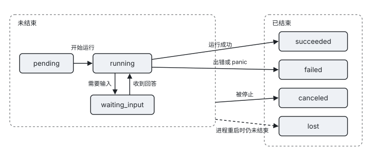

[← 上一章：系统提示词与动态上下文](11-prompt.md) · [目录](README.md) · [下一章：扩展机制 →](13-extensions.md)

# 12. 任务

任务让 agent 能够启动耗时的后台工作，例如 subagent、对其他 agent 的调用或你自己的 workflow，并在工作完成后自动通知模型。如果你需要接入一项要运行几分钟到几小时的工作，请阅读本章。读完本章，你可以实现自己的任务类型，让模型或宿主启动任务，并在宿主侧管理和观察任务。

本章内容：[12.1 实现一个任务类型](#121-实现一个任务类型) · [12.2 TaskCaps 与 TaskRuntime](#122-taskcaps-与-taskruntime) · [12.3 启动任务](#123-启动任务) · [12.4 宿主侧管理](#124-宿主侧管理) · [12.5 事件](#125-事件) · [12.6 状态与通知](#126-状态与通知) · [12.7 建议做法](#127-建议做法)

任务是一种异步能力。任务启动后立即返回 `task_id`，在它结束、失败或需要输入时，kernel 会主动把通知放进输入队列，并在会话空闲时自动开启一轮来处理这条通知，因此模型不需要轮询。只由任务通知和提醒触发的连续轮次最多为 `Limits.MaxConsecutiveAutoTurns` 轮，默认值为 8，达到上限后会等待用户输入。

SDK 内置了三种任务类型。`tool_exec` 由 kernel 自带，对应常量 `kernel.ToolExecKind`，用于把声明了 `Background` 的工具放到后台运行。`subagent` 用于运行 subagent，`a2a` 用于调用其他 agent。如果你有自己的长时间工作，可以实现 `kernel.Task` 接口。

## 12.1 实现一个任务类型

一个任务类型由 `kernel.TaskKind` 描述，其中的 `New` 负责创建实现了 `kernel.Task` 接口的实例。下面的例子实现了一个逐日规划行程的任务，它在每处理完一天后报告进度，并在 ctx 被取消时退出：

```go
type itinerary struct {
	Days []string `json:"days"`
}

var itineraryKind = kernel.TaskKind{
	Name:        "itinerary",
	Description: "Plans a trip one day at a time.",
	Caps:        kernel.TaskCaps{Restart: true},
	New: func(spec kernel.TaskSpec) (kernel.Task, error) { // 每次启动、重启和续接都会新建一个实例
		w := &itinerary{}
		return w, json.Unmarshal(spec.Input, w)
	},
}

func (w *itinerary) Run(ctx context.Context, rt kernel.TaskRuntime) (kernel.TaskResult, error) {
	var plan []string
	for i, day := range w.Days {
		select {
		case <-time.After(time.Second):
		case <-ctx.Done():
			return kernel.TaskResult{}, ctx.Err() // task_stop、Restart 和 Close 都会取消 ctx
		}
		plan = append(plan, fmt.Sprintf("Day %d: %s", i+1, day))
		pct := 100 * float64(i+1) / float64(len(w.Days))
		rt.Report(kernel.TaskProgress{Text: day, Percent: &pct})
	}
	return kernel.TaskResult{Summary: strings.Join(plan, "\n")}, nil
}
```

`TaskKind` 的字段如下：

| 字段 | 说明 |
|---|---|
| `Name` | 类型名，`TaskSpec.Kind` 通过它指定任务类型。 |
| `Description` | 给人看的说明。 |
| `Caps` | 声明这个类型支持哪些操作，详见下一节。 |
| `New` | 按 `TaskSpec` 创建一个新实例。每次启动、重启和续接都会调用一次，实例之间不共享状态。 |

`Run` 返回的 `TaskResult` 包含三个字段。`Summary` 是通知模型时使用的文字，`Content` 是可选的完整内容块，`Data` 是写入事件的结构化结果。如果 `Run` 返回 Go `error`，任务会被记为 `failed`，模型会看到错误文本。

任务类型可以在 agent 级用 `kernel.WithTaskKind(kind)` 注册，也可以在扩展中用 `r.TaskKind(kind)` 注册。session 级注册的类型会遮蔽 agent 级的同名类型。

## 12.2 TaskCaps 与 TaskRuntime

`TaskCaps` 声明一个任务类型支持哪些操作，管理器根据它决定接受还是拒绝某个操作：

| 字段 | 允许的操作 |
|---|---|
| `Instructions` | 允许在运行中追加指令，即使用 `task_send` 或 `Tasks().Send`。 |
| `Continue` | 允许在任务结束后续接。再次调用 `Send` 时，会用 `SaveState` 保存的状态新建一个实例接着运行。 |
| `Restart` | 允许重启任务。 |
| `Inspect` | 表示实例实现了 `kernel.TaskInspector`，即 `Inspect(ctx) (TaskProgress, error)`。调用 `task_status` 时会实时查询，而不是读取上一次报告的进度。 |

`TaskRuntime` 是任务与 session 之间唯一的通道。它是并发安全的，在这次运行结束之后，对它的任何写入都是空操作。它提供以下方法：

| 方法 | 用途 |
|---|---|
| `Report(p)` | 报告进度并发出 `task.progress` 事件，`task_status` 读取的就是这里报告的内容。`TaskProgress` 包含 `Text`、`Percent` 和 `Data`。 |
| `Inbox() <-chan TaskInstruction` | 接收追加的指令和对提问的回答。`TaskInstruction` 包含 `ID`、`Text`、`Data`、`Mode` 和 `Answer`，其中 `Answer` 表示这是对 `AskInput` 的回答。 |
| `AskInput(question)` | 表示任务需要输入。任务会转为 `waiting_input`，模型或宿主用 `task_send` 回答，回答从 `Inbox` 中送出。 |
| `SaveState(state)` | 保存续接所需的状态。状态存放在消息中，因此进程重启后仍能续接。 |
| `Holding(ins)` | 报告已从收件箱取出但尚未处理的指令。这次运行结束时，这些指令会列入 `unprocessed_instructions`，不会在无人知晓的情况下丢失。 |
| `Emit(p)` | 以这个任务的名义发出事件。 |
| `Relay(ctx, ev)` | 转发其他 session 的事件，例如你自己创建的子 session 的事件。 |
| `ID()`、`Spec()`、`Attempt()`、`TurnID()`、`Session()` | 分别返回任务 id、启动参数、当前是第几次运行、启动它的 turn 以及所属的 session。 |

如果任务需要处理追加的指令，通常在一个循环中同时等待收件箱、ctx 取消和自身工作的完成：

```go
for {
	select {
	case ins := <-rt.Inbox():
		if ins.Answer { /* 对 AskInput 的回答 */ } else { /* 追加的指令 */ }
	case <-ctx.Done():
		return kernel.TaskResult{}, ctx.Err()
	case <-done:
		return result, nil
	}
}
```

如果任务中需要创建子 session，请使用 `kernel.ChildOf(rt)`。这样创建的子 session，其事件会以任务的名义转发，模型调用会记入所属 session 的账本。任务可以等待这个子 session；反过来，子 session 中的工具或 hook 等待所属的 session 或任务时，会返回 `ErrReentrantWait`，见 [19.2](19-callback-rules.md#192-限制的原因)。

## 12.3 启动任务

任务可以由模型启动，也可以由宿主启动。

如果希望模型能够启动任务，可以用 `kernel.TaskTool` 生成一个启动工具。它会在工具的 schema 中加入一个 `background` 参数，让模型自己选择在前台等待还是在后台运行。如果 schema 不是 JSON 对象，或者其中已经有 `background` 属性，`TaskTool` 会返回错误。

```go
plan, err := kernel.TaskTool("itinerary", kernel.ToolSpec{
	Name:        "plan_itinerary",
	Description: "Research a day-by-day itinerary. Run it in the background for long trips.",
	InputSchema: json.RawMessage(`{"type":"object","properties":{"days":{"type":"array","items":{"type":"string"}}},"required":["days"]}`),
	Concurrency: kernel.Parallel,
}, func(in json.RawMessage) (kernel.TaskSpec, error) {
	return kernel.TaskSpec{Title: "itinerary", Input: in}, nil
})
if err != nil {
	log.Fatal(err)
}

ag, err := kernel.New(
	kernel.WithTaskKind(itineraryKind),
	kernel.WithTool(plan),
	// ...
)
```

宿主启动任务时，调用 `sess.Tasks().Start(ctx, spec)`。

两种方式都通过 `TaskSpec` 描述要启动的任务，它的字段如下：

| 字段 | 说明 |
|---|---|
| `Kind` | 任务类型名，使用 `TaskTool` 时会自动填写。 |
| `Title` | 给人看的标题，会出现在事件和通知中。 |
| `Input` | 交给 `New` 的输入。 |
| `Foreground` | 表示在前台运行，即启动它的工具调用会等待任务结束。如果任务中途需要输入或到了工具超时，工具调用会立即返回，任务转到后台继续运行。 |
| `NotifyMode` | 通知送达模型的方式，默认值为 `next_loop`。 |

任务启动前会触发 `task_start` hook，hook 可以拒绝启动，也可以改写 spec。如果在工具中启动任务失败，请用 `sess.TaskErrorResult(err)` 生成返回给模型的结果。其中只有启动被拒绝（`*kernel.TaskDeniedError`）和达到任务上限（`kernel.ErrTaskLimit`）会写成固定的文字；其他错误会套用 `task_start_failed` 模板，连同 Go 错误的原文一起交给模型。因此 `TaskTool` 的 `toSpec` 函数和任务类型的 `New` 返回的错误，都应该是可以让模型看到的文字。

## 12.4 宿主侧管理

宿主通过 `sess.Tasks()` 管理任务。它和模型使用的 `task_*` 工具操作的是同一个管理器，因此两边看到的任务状态始终一致。常用的方法如下：

```go
info, err := sess.Tasks().Start(ctx, kernel.TaskSpec{Kind: "itinerary", Title: "Kyoto", Input: in})
sess.Tasks().List()                 // 按创建顺序列出未结束的任务和最近结束的任务，最多保留 50 个
sess.Tasks().Get(id)
sess.Tasks().Inspect(ctx, id)       // 类型声明了 Caps.Inspect 时实时查询，否则等同于 Get
sess.Tasks().Send(ctx, id, kernel.TaskInstruction{Text: "加上奈良", Mode: kernel.ModeNextLoop})
sess.Tasks().Stop(ctx, id, "user canceled")
sess.Tasks().Restart(ctx, id, newInput) // 带新输入重启时，或恢复会话后第一次重启时，会重新经过审查
sess.Tasks().Wait(ctx, id)          // 等待任务结束或进入等待输入状态，重启不会中断等待
```

这些方法返回的 `TaskInfo` 包含以下字段：

| 字段 | 说明 |
|---|---|
| `ID`、`Kind`、`Title`、`Status`、`Attempt` | 任务的基本信息。`Attempt` 从 1 开始，每次重启或续接加一。 |
| `Foreground`、`CallID`、`TurnID` | 是否在前台运行，以及启动它的工具调用和 turn。由宿主启动的任务这两项为空。 |
| `StartedAt`、`EndedAt` | 开始时间和结束时间。 |
| `Progress` | 最近一次 `Report` 报告的内容。 |
| `Question` | 任务等待输入时提出的问题。 |
| `Result`、`Error` | 任务结束后的结果或错误文本。 |
| `Abandoned` | 表示任务在停止后的宽限期内没有退出，它之后做了什么无法得知。 |
| `PendingInstructions`、`UnprocessedInstructions` | 前者是收件箱中尚未取走的指令，后者是已取走但未处理的指令。 |
| `State` | 最近一次 `SaveState` 保存的内容。 |

## 12.5 事件

任务在生命周期中会发出以下事件：

| 事件 | 字段 |
|---|---|
| `task.started` | `TaskID`、`Kind`、`Title`、`Foreground`、`Attempt`、`CallID`、`Continuation`，以及包含 spec 与 state 的 `Detail`。 |
| `task.progress` | `TaskID`、`Text`、`Percent`、`Data`。 |
| `task.status_changed` | `TaskID`、`From`、`To`、`Question`。 |
| `task.instruction` | `TaskID`、`InstructionID`、`Mode`、`Text`、`Accepted`、`Reason`。 |
| `task.finished` | `TaskID`、`Status`、`Attempt`、`IsError`、`Summary`、`UnprocessedInstructions`、`DurationMs`。 |
| `tasks.snapshot` | 任务清单的快照。任务启动、结束或状态变化时，它会在对应的 `task.*` 事件之前发出，恢复会话时也会发出一次。 |

任务中发出的事件，包括通过 `rt.Emit` 发出的事件和子 session 的事件，都带有 `Path`。`Path` 的第一跳 `Kind` 为 `task`，`ID` 为任务 id。

## 12.6 状态与通知

任务创建后处于 `pending` 状态，开始运行后进入 `running`。运行中的任务需要输入时转为 `waiting_input`，收到回答后回到 `running`，两者之间可以多次往返。任务最终以 `succeeded`、`failed` 或 `canceled` 之一结束。如果进程重启时任务还没有结束，它会被记为 `lost`。模型会得知这一情况，但恢复的会话不会因此自动开启一轮。`TaskStatus.Terminal()` 用于判断任务是否已经结束，`lost` 也算作已结束。



`task_send` 的含义取决于任务当前的状态。任务正在运行时，它表示追加指令。任务在等待输入时，它表示回答问题。任务已经结束时，它表示续接，这要求任务类型声明了 `Continue`。

任务结束、失败或等待输入时，kernel 会生成一条任务通知并放进输入队列，通知的来源为 `task`。通知送达前会触发 `task_notify` hook，hook 可以修改通知的文字，也可以让通知不唤醒会话。模型自己用 `task_stop` 停掉的任务，以及被重启替换掉的那一次运行，都不会发出通知。宿主用 `Tasks().Stop` 停掉的任务和被 hook 停掉的任务则会发出通知。通知中的摘要有长度上限，为 8000 字符，更长的内容模型可以通过 `task_status{include_result:true}` 读取。

> 注意：
>
> - 打断 turn 不会停止后台任务。`/clear` 默认也不会停止后台任务，你可以通过 `ContextPolicy.StopTasksOnClear` 修改这一行为。
> - 一个 session 中同时未结束的任务默认最多 8 个，由 `Limits.MaxRunningTasks` 控制，超过时返回 `ErrTaskLimit`。
> - 每个任务的收件箱最多容纳 16 条指令。收件箱满了之后，`Tasks().Send` 和 `task_send` 会返回 `ErrQueueFull`。

## 12.7 建议做法

- 任务必须响应 `ctx.Done()`。`Stop`、`Restart` 和 `Close` 都通过取消 ctx 让任务退出，不退出的任务会被记为 `Abandoned`，它之后做了什么将无从得知。
- 建议有节制地报告进度。每次调用 `Report` 都会发出事件，并更新 `task_status` 看到的内容，按百分比的变化或每隔几秒报告一次就足够了。
- 运行时间长、可能被重启的任务应使用 `SaveState`。为类型声明 `Continue`，并在每个阶段结束时保存一次状态，这样进程重启后，用户只需一次 `task_send` 就能让任务接着运行。
- 运行在远端系统中的任务应声明 `Inspect`。这样调用 `task_status` 时会去远端查询，而不是报告上一次的进度。
- 不要用任务协议重新包装你自己写的后台工具。直接为工具设置 `Background: true`，kernel 会用 `tool_exec` 替你运行它，详见 [7.6](07-tools.md#76-把一次调用转到后台)。
- 在工具中启动任务失败时，建议用 `sess.TaskErrorResult(err)` 返回结果。除了拒绝和达到上限，它会把 Go 错误的原文交给模型，所以 `toSpec` 和 `New` 返回的错误里不要放不该让模型看到的内容。

---

[← 上一章：系统提示词与动态上下文](11-prompt.md) · [目录](README.md) · [下一章：扩展机制 →](13-extensions.md)
