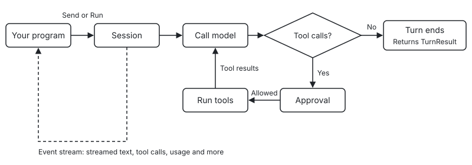

[Contents](README.md) · [Next: Quick start →](02-quickstart.md)

# 1. Introduction

This chapter explains what potatOS is, what it is good for, and how responsibilities are divided between it and your program. It then covers installation and the packages you use most often.

In this chapter: [1.1 What potatOS is](#11-what-potatos-is) · [1.2 Use cases](#12-use-cases) · [1.3 What the SDK does and what you do](#13-what-the-sdk-does-and-what-you-do) · [1.4 Installation](#14-installation) · [1.5 Common packages](#15-common-packages) · [1.6 How a turn runs](#16-how-a-turn-runs)

## 1.1 What potatOS is

potatOS is an agent core SDK written in Go for building agents inside your own programs.

Here, an agent means a program driven by a large language model that can call tools on its own to complete a task. At its core is a loop. The program hands the user's input to the model. If the model decides to call tools, the program runs those tools and gives the results back to the model, which then decides what to do next. This repeats until the model gives a final answer. Beyond this loop, a usable agent has to handle many other things, such as streaming output, running tools in parallel, retrying after errors, accepting new input while the model is working, asking a person to confirm before a dangerous operation, compacting the context when a conversation grows too long, and resuming a conversation after the process restarts.

potatOS implements exactly this part. On its own it is responsible for only three things: calling the model, running the agent loop and managing the context. Everything else that can be customized is open to you through registration, including the agent's nickname, the instructions in the system prompt, tools, background tasks, slash commands, hooks, approval rules, skills, long-term memory, the other agents it can call, and storage. Everything that happens during a run is emitted as an event. By subscribing to these events, your program can show the process to users or record it.

potatOS is embedded in your program as a library. It is not a standalone service, and it has no user interface. You create agents, send input and subscribe to events in your code. Whether the agent reaches your users as a command-line tool, a web service or a background program is up to your program.

## 1.2 Use cases

potatOS is a good fit when the product you are building needs an agent that can call tools and you want to control the interface, the deployment and the business logic yourself. Examples include a conversational assistant with tools, a business agent that runs in a web page and needs people to approve its operations, an agent that processes jobs in batches in the background, and a system that hands work off to subagents and other agents.

potatOS focuses on how an agent thinks and acts, not on how it is deployed and accessed. If you need a ready-made chat product, or you only want to call a model once without tools or a multi-turn loop, calling the model vendor's API directly is simpler.

## 1.3 What the SDK does and what you do

The SDK gives you the following:

- Three model APIs: Anthropic Messages, OpenAI Chat Completions and OpenAI Responses. Chat Completions support also works with compatible services such as DeepSeek, Qwen, vLLM, Ollama, OpenRouter and LiteLLM.
- The agent loop, including an input queue, parallel tools, retries, interrupts and an event stream.
- Context management, including a system prompt with a fixed structure, automatic compaction, rewind, forks and history search.
- Hooks, approval rules and approvers, and the task (background work) protocol.
- Built-in extensions, including subagents, skills, memory, an A2A client, an MCP client, slash commands and cost queries.
- JSONL storage and session resume.

You are responsible for the following:

- The UI, CLI or HTTP service.
- Authentication and multi-tenancy.
- Model configuration. The SDK has no built-in model table. You declare capabilities such as the context window and the output limit, or they are looked up at runtime.
- The approver's interface, which can be a terminal, a web page or another service.
- The A2A server.
- The storage backend you use in production. You only need to implement one interface to plug it in.

The SDK depends only on the standard library, with one exception: the MCP client, `ext/mcp`, uses the official MCP Go SDK together with `golang.org/x/oauth2` and `jsonschema-go`. It does not depend on any model vendor's official SDK, and it does not assume that the host machine has a shell or a file system. All built-in text sent to the model is in English, uses neutral wording and contains no product names.

## 1.4 Installation

Install it with `go get`:

```bash
go get github.com/estonshi/aperture-potatos
```

The MCP client, `ext/mcp`, is part of this module as well, so you do not need to install it separately. It depends on the official MCP Go SDK together with `golang.org/x/oauth2` and `jsonschema-go`. If your program does not import `ext/mcp`, these libraries are not compiled into it.

> Note: potatOS requires Go 1.25 or later.

### Supported spec versions

The events, session file format, prompt text and defaults of potatOS are defined by a language-independent specification in the repository's `spec/` directory, and implementations in other languages follow the same specification. The spec is versioned with SemVer. The current version is in `spec/VERSION`, and the change log is in `spec/CHANGELOG.md`.

This Go implementation supports spec 0.2, shipped by the `v0.2.y` SDK releases. The spec is numbered `MAJOR.MINOR` and has no PATCH release; the SDK is numbered `vMAJOR.MINOR.PATCH`, and every `v0.2.y` satisfies spec 0.2.

- A new session records `0.2` in the `spec_version` field of the `session.started` event and in the first line of the session file, and the data it writes contains only fields defined by spec 0.2.
- When a session is resumed, whether it can be read depends on the line format version `v`, not on the spec version recorded in the first line. Any session file whose `v` is 1 can be read, including files written by implementations in other languages. If `v` is higher, resume returns `store.ErrIncompatibleStore`.
- When the SDK reads data written by a newer version, it ignores unknown fields, keeps unknown content blocks as `*message.OpaqueBlock`, and decodes unknown event types as `*event.Unknown`.

## 1.5 Common packages

The table below lists the packages you use most often during development. In the table, `...` stands for the module path `github.com/estonshi/aperture-potatos`.

| Import path | Purpose | Main chapters |
|---|---|---|
| `.../kernel` | Provides the whole public API, including Agent, Session, tools, hooks, tasks and commands. | All |
| `.../std` | Installs the default extensions in one line of code. | [13.4](13-extensions.md#134-installing-the-default-extensions-with-std) |
| `.../provider` | Provides model references, parameters, capability declarations, retry policies and error classification. | [4](04-models.md) |
| `.../provider/anthropic`, `.../provider/openaichat`, `.../provider/openairesponses` | The adapters for the three model APIs. | [4.1](04-models.md#41-the-three-adapters) |
| `.../provider/providertest` | Provides a scripted provider and HTTP replay for tests. | [21](21-testing.md) |
| `.../message` | Defines messages, content blocks, usage and Pin. | [6](06-events.md), [16](16-storage.md) |
| `.../event` | Defines the event envelope and the payload of each kind of event. | [6](06-events.md) |
| `.../store`, `.../store/jsonl` | Provides the storage interface, an in-memory implementation and a JSONL implementation. | [16](16-storage.md) |
| `.../ext/compact`, `.../ext/history`, `.../ext/tasks`, `.../ext/subagent` | Extensions that are installed by default. | [14](14-builtin-extensions.md) |
| `.../ext/skills`, `.../ext/memory`, `.../ext/peer`, `.../ext/peer/a2a`, `.../ext/mcp` | Extensions that are installed only after you configure them. | [14](14-builtin-extensions.md) |
| `.../ext/cmd/<name>cmd` | The seven built-in slash commands, one package per command. | [10.5](10-commands.md#105-built-in-commands) |
| `.../ext/litellm` | Tags requests and queries cost when you call models through a LiteLLM gateway. | [17](17-usage-cost.md) |

## 1.6 How a turn runs

An `Agent` is a configuration. One Agent can create many `Session`s, and each Session represents one conversation. After you send input to a Session, it processes one turn in the background. During the turn, the Session keeps emitting events, such as streamed text, tool calls and usage, and it returns a result when the turn ends.

The diagram below shows how a turn is processed:



Each stage in the flow has its own chapter. Sending input is covered in Chapter [5](05-input.md), events in Chapter [6](06-events.md), models in Chapter [4](04-models.md), tools in Chapter [7](07-tools.md), and approval in Chapter [8](08-approval.md). If you want to step in at any stage, read Chapter [9](09-hooks.md).

---

[Contents](README.md) · [Next: Quick start →](02-quickstart.md)
