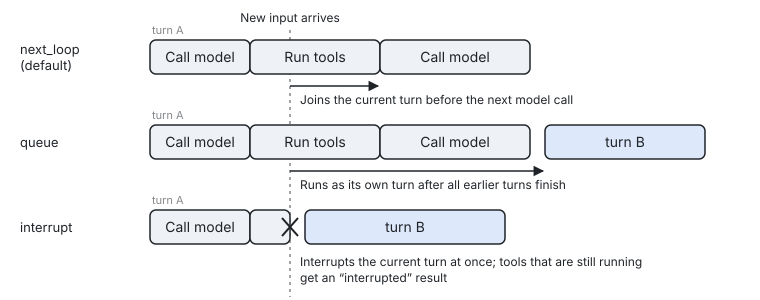

[← Previous: Connecting models](04-models.md) · [Contents](README.md) · [Next: Subscribing to events →](06-events.md)

# 5. Sending input and waiting for results

This chapter explains how to hand the agent what the user said, a command or a notice from the host, and how to get the result of the turn. It also explains when new input is delivered while the agent is busy, how to interrupt a running turn, and the usual ways to integrate the SDK into a CLI or a web service.

In this chapter: [5.1 Three ways to send input](#51-three-ways-to-send-input) · [5.2 Input content and send options](#52-input-content-and-send-options) · [5.3 Receipts](#53-receipts) · [5.4 The three modes while the agent is busy](#54-the-three-modes-while-the-agent-is-busy) · [5.5 Sending reminders that do not wake the agent](#55-sending-reminders-that-do-not-wake-the-agent) · [5.6 Interrupting a turn](#56-interrupting-a-turn) · [5.7 Withdrawing a queued input or sending it now](#57-withdrawing-a-queued-input-or-sending-it-now) · [5.8 TurnResult](#58-turnresult) · [5.9 Input events](#59-input-events) · [5.10 Common integrations](#510-common-integrations) · [5.11 Best practices](#511-best-practices)

## 5.1 Three ways to send input

A session offers three ways to send input. `Send` returns a receipt immediately, and you can wait for the result later. `Run` sends the input and iterates over the events the turn produces. `Command` runs a command directly, without parsing any text:

```go
// 1. Send: returns a receipt immediately; wait for the result later
rcpt, err := sess.Send(kernel.Text("Book me a hotel"))
res, err := rcpt.Wait(ctx) // TurnResult

// 2. Run: sends the input and iterates over the turn's events until turn.completed
for ev, err := range sess.Run(ctx, kernel.Text("Continue")) { ... }

// 3. Command: runs a command directly, without text parsing
rcpt, err = sess.Command("compact", "Keep the conclusions about the budget")
```

If text passed to `Send` has the human origin, starts with `/`, and the `/` is followed by a registered command name or alias, the text runs as a command. If what follows the `/` is not a registered name, the text is sent to the model as ordinary content. Start the text with `//` to send a literal slash. You can turn this parsing off with `kernel.NoCommandParsing()`.

Breaking out of `Run` partway through or canceling ctx only stops the iteration; it does not stop the turn. If what you sent is a command, `Run` keeps yielding that command's events until `command.completed`.

If ending iteration should also stop the work this input started, use `RunCancelable`: it interrupts only the turn this input is already in, or withdraws the input while it is still queued. A command is left to finish.

If you want to wait until the whole session is quiet, use `sess.WaitQuiet(ctx)`. Quiet means that the turn has ended, the queued commands have run, the background tasks have finished, and the task notifications have been sent. `WaitQuiet` returns the `TurnResult` of the last turn.

## 5.2 Input content and send options

An input is described by `kernel.Input`. Besides text, it can carry images or documents, origin information and custom metadata:

```go
kernel.Input{
	Text:     "Take a look at this image",
	Parts:    message.Content{&message.ImageBlock{MediaType: "image/png", Data: png}}, // images or documents
	Origin:   message.Origin{Kind: message.OriginHuman},                                // defaults to human
	Metadata: map[string]string{"request_id": "r-1"},                                  // not interpreted by the kernel; read it in tools with tc.InputMetadata()
}
```

`kernel.Text(s)` is shorthand for an input that contains only text. `Parts` can hold `*message.ImageBlock` and `*message.DocumentBlock` values. An `ImageBlock` needs `MediaType` and either `Data` or `URL`. A `DocumentBlock` has the same fields plus `Filename`.

`Origin.Kind` accepts only four values: `human` for something the user said, `command` for content expanded from a command, `agent` for a message from another agent, and `reminder` for a runtime reminder. Any other value returns `ErrInvalidOrigin`. `Origin.Source` is a free-text label, such as `"app:prefs"` or `"hook:audit"`, that both the model and hooks can see.

`Send` and `Run` both accept the following send options:

| Option | Purpose |
|---|---|
| `kernel.WithMode(m)` | Sets the busy mode for this input; see [5.4](#54-the-three-modes-while-the-agent-is-busy). |
| `kernel.WithOrigin(o)` | Has the same effect as setting `Input.Origin`. |
| `kernel.WithMetadata(md)` | Has the same effect as setting `Input.Metadata`. |
| `kernel.NoWake()` | Does not start a new turn for this input. The input is delivered together with the next model call or the next turn. |
| `kernel.NoCommandParsing()` | Treats text that starts with `/` as ordinary input as well. |

## 5.3 Receipts

`Send` and `Command` return a `*kernel.Receipt`, which you use to wait for the result or to get the input's id. A receipt provides the following methods:

| Method | Description |
|---|---|
| `Wait(ctx) (TurnResult, error)` | Waits for the turn that contains this input to end, or for the command to finish if the input is a command. It returns an error only when the wait itself fails, for example when ctx is canceled or the session is closed. To find out how the turn ended, check the `TurnResult`. |
| `Done() <-chan struct{}` | Closed when the input is finished, so you can use it in a select. |
| `InputID() string` | Returns this input's id, which matches `input_id` in events. |

An input may be merged with other inputs into the same turn; the next section explains the rules. When that happens, their receipts return the same `TurnResult`.

## 5.4 The three modes while the agent is busy

While the agent is processing a turn, the busy mode determines how a newly arrived input is delivered. The SDK provides three modes:

| Mode | Behavior |
|---|---|
| `kernel.ModeNextLoop` (default) | The input is delivered into the current turn after the current batch of tools finishes and before the next model call. If the turn has already ended, the input becomes input for the next turn. |
| `kernel.ModeQueue` | The input waits until all earlier turns have ended, and then starts a turn of its own. |
| `kernel.ModeInterrupt` | The current turn is interrupted immediately, the tools that are running get an "interrupted" result, and the input is processed right away. |

The diagram below shows when the same new input is delivered under each of the three modes:



Specify the mode with `kernel.WithMode` when you send the input:

```go
sess.Send(kernel.Text("Change it to Osaka"), kernel.WithMode(kernel.ModeInterrupt))
```

You can change the default mode at the agent level with `kernel.WithInputMode`, or at the session level with `kernel.SessionInputMode`. A command waiting in the queue acts as a barrier: any input that arrives after it is delivered only after the command has run.

Each mode suits a different situation. If the user adds "check Osaka too while you're at it" while the model is working, the default `next_loop` fits, because the model sees the message at its next step. If the user clicks "Stop and start over", `interrupt` fits. For follow-up questions that the system feeds in bulk, `queue` fits.

## 5.5 Sending reminders that do not wake the agent

Sometimes the host needs to give the model a piece of background information without making the model respond to it. In that case, send a reminder with the `NoWake` option:

```go
prefs := message.Origin{Kind: message.OriginReminder, Source: "app:prefs"}
sess.Send(kernel.Input{Text: "The user prefers trains to flights.", Origin: prefs}, kernel.NoWake())
```

The reminder is delivered together with the next turn or the next model call. `sess.Announce(source, text, payload)` has the same effect and can also emit an event. `ag.Announce` sends one reminder to each open session of the agent.

Reminders carry a label when they are sent to the model. The system prompt already tells the model that a reminder is not something the user said and does not carry the user's authorization.

## 5.6 Interrupting a turn

When you need to stop a running turn, you can use the following three methods:

| Method | Effect |
|---|---|
| `sess.Interrupt(reason)` | Interrupts the running turn. Background tasks keep running. Human, command and agent inputs that the turn has already taken but not yet written to the history are discarded, and `input.dropped{interrupted}` is emitted. Inputs that were being added to the turn partway through go back to the queue. |
| `sess.InterruptAndDrop(reason)` | Interrupts the turn and discards the human, command and agent inputs in the queue. Reminders are kept. |
| `sess.InterruptTurn(turnID, reason)` | Interrupts only the specified turn. Use this method when you want to stop a turn you are waiting on. It keeps you from stopping the next turn by mistake if the turn you meant has just ended and the next one has just begun. |

All three methods return immediately. The return value tells you whether there was a turn to interrupt at the time of the call.

An interrupt proceeds in the following order:

1. The SDK first emits a `turn.interrupt_requested` event and then cancels the turn's ctx. The cancellation cause of the interrupted turn's ctx is `*kernel.InterruptError{Reason}`.
2. Tools that are running get a grace period of `Limits.ToolCancelGrace` to exit, 3s by default. A call that still has not exited after that is recorded as abandoned, and `tool.abandoned` is emitted.
3. Every unfinished tool call in the history gets an "interrupted" result.
4. The turn ends with `interrupted`.

## 5.7 Withdrawing a queued input or sending it now

While the agent is busy, the messages that the user sends wait in the queue first. If the user changes their mind, you can withdraw a message that is still queued. If the user wants a message handled right away, you can turn it into an interrupt, so that the agent stops the current turn and processes that message immediately. Both operations work for messages sent in queue or next_loop mode, and you identify the message by the input id you got when you sent it:

```go
rcpt, _ := sess.Send(kernel.Text("Check Osaka too while you're at it"), kernel.WithMode(kernel.ModeQueue))

// The user clicks "Withdraw"
err := sess.Withdraw(rcpt.InputID())

// Or the user clicks "Send now"
err = sess.InterruptWith(rcpt.InputID())
```

`Withdraw` removes the message from the queue, so the model never sees it. The SDK emits an `input.dropped` event with the reason `withdrawn`. The message's receipt finishes at that point, with `TurnResult.Outcome` set to `dropped`.

`InterruptWith` has the same effect as if the message had been sent with `ModeInterrupt` in the first place. The running turn is interrupted immediately, and the `Reason` of the `turn.interrupt_requested` event states which input triggered the interrupt. If an interrupt had already been requested for this turn, the event is not emitted again. Inputs that the interrupted turn had already taken but not yet written to the history go back to the queue and are not lost. After that, delivery order is the same as usual: next_loop messages enter the next turn together with this message, in order of arrival, and queue messages still each start a turn of their own. If this message was sent with `NoWake`, turning it into an interrupt wakes the session as well.

These two methods work only on messages that are still in the queue. If a turn has already taken the message when you call them, they return `kernel.ErrNotQueued` and change nothing. A message can be taken in one of two ways. In the first, a default-mode message has already been delivered into the current turn when the current batch of tools finished; the model will see it at the next call, so you do not need to do anything. In the second, the message is being delivered as the input of a new turn. The methods also return `ErrNotQueued` in the following cases:

- The message has already been dropped or withdrawn, or the id does not exist.
- The id refers to a queued command, such as a `/compact` entered while the agent was busy.
- You call `Withdraw` on a task notification. Task notifications are always delivered and cannot be withdrawn, but you can rewrite their text in the `task_notify` hook or make them not wake the session.
- You call `Withdraw` on the reminder that the SDK queues automatically when you call `Unpin`. That reminder must be written to the history; otherwise, the revoked Pin would reappear after the session is resumed.

Calling `InterruptWith` on task notifications and on that reminder is allowed.

`ErrNotQueued` only means that the message was not in the queue at the moment of the call. It does not mean that the message has definitely been delivered. If the turn that took the message is interrupted before it writes the message to the history, the message can go back to the queue, and you can then still withdraw it or turn it into an interrupt.

> Note: When a command is waiting in the queue, a message queued behind it still waits for that command to run before it is delivered, even after you turn the message into an interrupt. If the session is running a command such as compaction, a message turned into an interrupt starts a new turn after the command finishes.

Both methods return once the session has processed the request, but they do not wait for the turn to end, so you can also call them from tools, hooks and event callbacks. The request is always processed after the inputs sent before it, so `Withdraw` never runs before the message it withdraws has been queued. However, if the session happens to be idle, the message may already have started a new turn before you call `Withdraw`, and in that case the call also returns `ErrNotQueued`.

## 5.8 TurnResult

`Receipt.Wait` returns a `kernel.TurnResult`, which describes how the turn ended, along with the turn's usage and final text. `TurnResult` has the following fields:

| Field | Description |
|---|---|
| `TurnID` | The id of the turn. |
| `Outcome` | How the turn ended. The values are listed in the table below. |
| `StopReason` | The stop reason of the last model call, such as `end_turn`, `tool_use`, `max_tokens` or `refusal`. |
| `Steps` | The number of model calls in the turn. |
| `Usage` | The total usage of the turn. |
| `FinalText` | The last piece of assistant text in the turn, for callers that need only the final answer. |
| `Command` | The command's result when the receipt belongs to a command, of type `*CommandResult`. |
| `Err` | The error when the outcome is `error`. |

`Outcome` takes the following values:

| `Outcome` | Meaning |
|---|---|
| `completed` | The turn ended normally. |
| `max_steps` | The turn hit the `Limits.MaxSteps` limit. There is no limit by default, so this value appears only if you set one. |
| `max_tokens` | The reply was cut off by the output limit. |
| `refused` | The model refused to answer or was blocked by a content filter. The reply is not written to the history. |
| `hook_stopped` | A hook or an approver stopped the turn. |
| `interrupted` | The turn was interrupted. |
| `error` | The turn hit an error that cannot be retried, or it ran out of retries. |
| `canceled` | The session was closed. |
| `dropped` | The input was discarded before any turn used it, for example because `InterruptAndDrop` was called or a hook blocked it. |
| `command` | The receipt belongs to a command. |

Whatever the outcome, the history remains valid. Every tool call that was not executed gets a result, so the next turn can continue right away.

## 5.9 Input events

From the moment an input is accepted, through its delivery, until the turn it belongs to ends, it produces the following events in order:

| Event | When it is emitted | Main fields |
|---|---|---|
| `input.accepted` | `Send` has accepted the input. | `InputID`, `Mode`, `Origin`, `Text`, `QueueLen` |
| `input.injected` | The input has been delivered to a step of a turn. | `InputIDs`, `TurnID`, `Step` |
| `input.dropped` | The input has been discarded. | `InputID`, `Reason` |
| `turn.started` | A turn has started. | `TurnID`, `Trigger` (`human`, `command`, `agent`, `task`, `reminder`), `InputIDs` |
| `turn.interrupt_requested` | A caller has requested an interrupt. | `TurnID`, `Reason` |
| `turn.completed` | A turn has ended. | `TurnID`, `Outcome`, `StopReason`, `Steps`, `Usage`, `Error`, `DurationMs` |

## 5.10 Common integrations

This section shows how to write the code for several common scenarios.

### Command-line programs

A command-line program usually reads one line at a time, sends it, prints the turn's text as it streams, and reads the next line once the turn has ended:

```go
for {
	line := readLine()
	for ev, err := range sess.Run(ctx, kernel.Text(line)) {
		if err != nil {
			return err
		}
		if d, ok := ev.Data.(*event.MessageDelta); ok && len(ev.Path) == 0 {
			fmt.Print(d.Text)
		}
	}
	fmt.Println()
}
```

### Web services

A web service usually pushes events to the front end over one long-lived connection, and uses separate requests to send input and interrupts:

```go
// GET /sessions/{id}/events: pushes events over a long-lived SSE connection
sub, _ := sess.Subscribe(ch, kernel.WithTypes("message.", "tool.", "turn.", "approval.", "input."))
defer sub.Unsubscribe()
for ev := range ch {
	writeSSE(w, ev) // ev can be passed to json.Marshal directly
}

// POST /sessions/{id}/messages: returns immediately without waiting for the turn to end
rcpt, err := sess.Send(kernel.Text(body.Text), kernel.WithMetadata(map[string]string{"request_id": reqID}))
respond(w, map[string]string{"input_id": rcpt.InputID()})

// POST /sessions/{id}/interrupt
sess.Interrupt("user clicked stop")

// POST /sessions/{id}/messages/{input_id}/withdraw
if err := sess.Withdraw(inputID); errors.Is(err, kernel.ErrNotQueued) {
	respond(w, map[string]string{"status": "not_queued"}) // already taken, already withdrawn, or the id does not exist
}

// POST /sessions/{id}/messages/{input_id}/send-now
err = sess.InterruptWith(inputID)
```

### Getting only the final answer

If the caller cares only about the final answer and not the steps in between, send the input, wait for the result, and read `FinalText`:

```go
rcpt, _ := sess.Send(kernel.Text(q))
res, err := rcpt.Wait(ctx)
answer := res.FinalText
```

## 5.11 Best practices

- The "Stop" button in your UI should call `Interrupt`, not `Close`. After you call `Close`, the session can no longer be used.
- When the user speaks again while the model is working, just call `Send` with the default mode. The model sees the new input at its next step, which uses fewer tokens than interrupting and starting over.
- Put the request id in `Metadata` and read it in tools with `tc.InputMetadata()`, so that you can trace each request end to end.
- Send programmatic background information as a reminder with `NoWake`; do not disguise it as something the user said. The model treats the two kinds of content differently, and your audit logs also stay clearer.
- Your UI can offer "Withdraw" and "Send now" buttons for queued messages. Once you receive `input.injected`, a `turn.started` that includes the message's id, or `input.dropped`, mark the message as delivered or withdrawn. If a button's call returns `ErrNotQueued`, the message is not in the queue at that moment. You can gray out the buttons first, and then use the events that follow to tell whether the message was delivered or went back to the queue.
- If `Send` returns `ErrQueueFull`, just ask the user to wait a moment; do not keep retrying. The queue holds at most 256 inputs, which is controlled by `Limits.MaxQueuedInputs`.
- Do not let several users share one session. A session runs only one turn at a time, so everyone else's input can only wait in the queue.

---

[← Previous: Connecting models](04-models.md) · [Contents](README.md) · [Next: Subscribing to events →](06-events.md)
