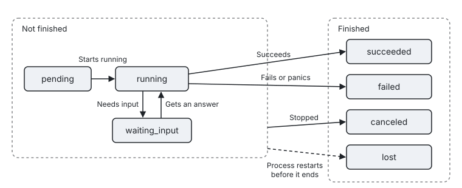

[← Previous: System prompt and dynamic context](11-prompt.md) · [Contents](README.md) · [Next: Extensions →](13-extensions.md)

# 12. Tasks

Tasks let an agent start long-running background work, such as a subagent, a call to another agent or a workflow of your own, and notify the model automatically when the work is done. Read this chapter if you need to integrate work that runs for minutes or hours. After reading it, you can implement your own task kinds, let the model or the host start tasks, and manage and observe tasks from the host.

In this chapter: [12.1 Implementing a task kind](#121-implementing-a-task-kind) · [12.2 TaskCaps and TaskRuntime](#122-taskcaps-and-taskruntime) · [12.3 Starting tasks](#123-starting-tasks) · [12.4 Managing tasks from the host](#124-managing-tasks-from-the-host) · [12.5 Events](#125-events) · [12.6 States and notifications](#126-states-and-notifications) · [12.7 Best practices](#127-best-practices)

A task is an asynchronous capability. Starting a task returns a `task_id` immediately. When the task ends, fails or needs input, the kernel puts a notification into the input queue on its own and, once the session is idle, automatically starts a turn to handle it, so the model never needs to poll. At most `Limits.MaxConsecutiveAutoTurns` consecutive turns, 8 by default, can be triggered by task notifications and reminders alone. Once that limit is reached, the session waits for user input.

The SDK has three built-in task kinds. `tool_exec` comes with the kernel, has the constant `kernel.ToolExecKind`, and runs tools that declare `Background` in the background. `subagent` runs a subagent, and `a2a` calls another agent. If you have long-running work of your own, implement the `kernel.Task` interface.

## 12.1 Implementing a task kind

A task kind is described by a `kernel.TaskKind`, whose `New` creates instances that implement the `kernel.Task` interface. The following example implements a task that plans a trip one day at a time. It reports progress after finishing each day and exits when ctx is canceled:

```go
type itinerary struct {
	Days []string `json:"days"`
}

var itineraryKind = kernel.TaskKind{
	Name:        "itinerary",
	Description: "Plans a trip one day at a time.",
	Caps:        kernel.TaskCaps{Restart: true},
	New: func(spec kernel.TaskSpec) (kernel.Task, error) { // a new instance is created for every start, restart and continuation
		w := &itinerary{}
		return w, json.Unmarshal(spec.Input, w)
	},
}

func (w *itinerary) Run(ctx context.Context, rt kernel.TaskRuntime) (kernel.TaskResult, error) {
	var plan []string
	for i, day := range w.Days {
		select {
		case <-time.After(time.Second):
		case <-ctx.Done():
			return kernel.TaskResult{}, ctx.Err() // task_stop, Restart and Close all cancel ctx
		}
		plan = append(plan, fmt.Sprintf("Day %d: %s", i+1, day))
		pct := 100 * float64(i+1) / float64(len(w.Days))
		rt.Report(kernel.TaskProgress{Text: day, Percent: &pct})
	}
	return kernel.TaskResult{Summary: strings.Join(plan, "\n")}, nil
}
```

`TaskKind` has the following fields:

| Field | Description |
|---|---|
| `Name` | The kind name. `TaskSpec.Kind` uses it to select the task kind. |
| `Description` | A human-readable description. |
| `Caps` | Declares which operations this kind supports. See the next section. |
| `New` | Creates a new instance from a `TaskSpec`. It is called once for every start, restart and continuation, and instances share no state. |

The `TaskResult` that `Run` returns has three fields. `Summary` is the text used to notify the model, `Content` is an optional block of full content, and `Data` is a structured result written into events. If `Run` returns a Go `error`, the task is recorded as `failed` and the model sees the error text.

You can register a task kind at agent level with `kernel.WithTaskKind(kind)` or from an extension with `r.TaskKind(kind)`. A kind registered at session level shadows an agent-level kind with the same name.

## 12.2 TaskCaps and TaskRuntime

`TaskCaps` declares which operations a task kind supports, and the manager uses it to decide whether to accept or reject an operation:

| Field | Operation it allows |
|---|---|
| `Instructions` | Adding instructions while the task runs, through `task_send` or `Tasks().Send`. |
| `Continue` | Continuing the task after it has ended. Calling `Send` again creates a new instance that picks up from the state saved with `SaveState`. |
| `Restart` | Restarting the task. |
| `Inspect` | Indicates that the instance implements `kernel.TaskInspector`, that is, `Inspect(ctx) (TaskProgress, error)`. `task_status` then queries the task live instead of reading the last reported progress. |

`TaskRuntime` is the only channel between a task and its session. It is safe for concurrent use, and once this run has ended, any write to it is a no-op. It provides the following methods:

| Method | Purpose |
|---|---|
| `Report(p)` | Reports progress and emits a `task.progress` event. What you report here is what `task_status` reads. `TaskProgress` contains `Text`, `Percent` and `Data`. |
| `Inbox() <-chan TaskInstruction` | Receives added instructions and answers to questions. `TaskInstruction` contains `ID`, `Text`, `Data`, `Mode` and `Answer`, where `Answer` indicates that this is an answer to `AskInput`. |
| `AskInput(question)` | Signals that the task needs input. The task moves to `waiting_input`, the model or the host answers with `task_send`, and the answer is delivered through `Inbox`. |
| `SaveState(state)` | Saves the state needed to continue. The state is stored in messages, so the task can still be continued after the process restarts. |
| `Holding(ins)` | Reports instructions that have been taken from the inbox but not yet handled. When this run ends, these instructions are listed in `unprocessed_instructions`, so they are not lost without anyone knowing. |
| `Emit(p)` | Emits an event on behalf of this task. |
| `Relay(ctx, ev)` | Forwards events from another session, such as a child session you created yourself. |
| `ID()`, `Spec()`, `Attempt()`, `TurnID()`, `Session()` | Return the task id, the start parameters, the number of the current run, the turn that started the task, and the session it belongs to. |

A task that needs to handle added instructions usually waits on the inbox, ctx cancellation and the completion of its own work in a single loop:

```go
for {
	select {
	case ins := <-rt.Inbox():
		if ins.Answer { /* an answer to AskInput */ } else { /* an added instruction */ }
	case <-ctx.Done():
		return kernel.TaskResult{}, ctx.Err()
	case <-done:
		return result, nil
	}
}
```

If a task needs to create a child session, use `kernel.ChildOf(rt)`. For a child session created this way, its events are forwarded on behalf of the task, and its model calls are recorded in the ledger of the session the task belongs to. The task can wait on this child session, but a tool or hook in the child session that waits on the session or task that owns it gets `ErrReentrantWait`; see [19.2](19-callback-rules.md#192-why-the-rules-exist).

## 12.3 Starting tasks

Tasks can be started by the model or by the host.

To let the model start a task, generate a start tool with `kernel.TaskTool`. It adds a `background` parameter to the tool's schema so that the model can choose whether to wait in the foreground or run in the background. If the schema is not a JSON object or already has a `background` property, `TaskTool` returns an error.

```go
plan, err := kernel.TaskTool("itinerary", kernel.ToolSpec{
	Name:        "plan_itinerary",
	Description: "Research a day-by-day itinerary. Run it in the background for long trips.",
	InputSchema: json.RawMessage(`{"type":"object","properties":{"days":{"type":"array","items":{"type":"string"}}},"required":["days"]}`),
	Concurrency: kernel.Parallel,
}, func(in json.RawMessage) (kernel.TaskSpec, error) {
	return kernel.TaskSpec{Title: "itinerary", Input: in}, nil
})
if err != nil {
	log.Fatal(err)
}

ag, err := kernel.New(
	kernel.WithTaskKind(itineraryKind),
	kernel.WithTool(plan),
	// ...
)
```

To start a task from the host, call `sess.Tasks().Start(ctx, spec)`.

Both approaches describe the task to start with a `TaskSpec`, which has the following fields:

| Field | Description |
|---|---|
| `Kind` | The task kind name. `TaskTool` fills it in for you. |
| `Title` | A human-readable title that appears in events and notifications. |
| `Input` | The input passed to `New`. |
| `Foreground` | Runs the task in the foreground, meaning the tool call that started it waits for the task to end. If the task needs input partway through or the tool times out, the tool call returns immediately and the task keeps running in the background. |
| `NotifyMode` | How the notification reaches the model. The default is `next_loop`. |

Before a task starts, the `task_start` hook fires. The hook can refuse the start or rewrite the spec. If starting a task from a tool fails, use `sess.TaskErrorResult(err)` to build the result returned to the model. Only a refused start (`*kernel.TaskDeniedError`) and a reached task limit (`kernel.ErrTaskLimit`) get fixed wording. Any other error goes to the model through the `task_start_failed` template, together with the raw text of the Go error. The errors returned by the `toSpec` function of `TaskTool` and by the task kind's `New` must therefore be text the model may see.

## 12.4 Managing tasks from the host

The host manages tasks through `sess.Tasks()`. It operates on the same manager as the `task_*` tools the model uses, so both sides always see the same task state. The common methods are:

```go
info, err := sess.Tasks().Start(ctx, kernel.TaskSpec{Kind: "itinerary", Title: "Kyoto", Input: in})
sess.Tasks().List()                 // lists unfinished and recently finished tasks in creation order, keeping at most 50
sess.Tasks().Get(id)
sess.Tasks().Inspect(ctx, id)       // queries live when the kind declares Caps.Inspect; otherwise the same as Get
sess.Tasks().Send(ctx, id, kernel.TaskInstruction{Text: "Add Nara", Mode: kernel.ModeNextLoop})
sess.Tasks().Stop(ctx, id, "user canceled")
sess.Tasks().Restart(ctx, id, newInput) // goes through approval again when restarted with new input, or on the first restart after the session is resumed
sess.Tasks().Wait(ctx, id)          // waits until the task ends or starts waiting for input; a restart does not end the wait
```

The `TaskInfo` these methods return has the following fields:

| Field | Description |
|---|---|
| `ID`, `Kind`, `Title`, `Status`, `Attempt` | Basic information about the task. `Attempt` starts at 1 and increases by one on every restart or continuation. |
| `Foreground`, `CallID`, `TurnID` | Whether the task runs in the foreground, and the tool call and turn that started it. For a task started by the host, the last two are empty. |
| `StartedAt`, `EndedAt` | The start time and end time. |
| `Progress` | What the most recent `Report` reported. |
| `Question` | The question the task asked while waiting for input. |
| `Result`, `Error` | The result or error text after the task ends. |
| `Abandoned` | Indicates that the task did not exit within the grace period after it was stopped, so there is no way to know what it did afterward. |
| `PendingInstructions`, `UnprocessedInstructions` | The first holds instructions still waiting in the inbox; the second holds instructions that were taken but not handled. |
| `State` | What the most recent `SaveState` saved. |

## 12.5 Events

A task emits the following events over its lifecycle:

| Event | Fields |
|---|---|
| `task.started` | `TaskID`, `Kind`, `Title`, `Foreground`, `Attempt`, `CallID`, `Continuation`, and `Detail`, which contains the spec and the state. |
| `task.progress` | `TaskID`, `Text`, `Percent`, `Data`. |
| `task.status_changed` | `TaskID`, `From`, `To`, `Question`. |
| `task.instruction` | `TaskID`, `InstructionID`, `Mode`, `Text`, `Accepted`, `Reason`. |
| `task.finished` | `TaskID`, `Status`, `Attempt`, `IsError`, `Summary`, `UnprocessedInstructions`, `DurationMs`. |
| `tasks.snapshot` | A snapshot of the task list. When a task starts, ends or changes state, it is emitted before the corresponding `task.*` event. It is also emitted once when a session is resumed. |

Events emitted from within a task, including those emitted through `rt.Emit` and those of child sessions, carry a `Path`. The first hop of `Path` has `Kind` set to `task` and `ID` set to the task id.

## 12.6 States and notifications

A newly created task is in the `pending` state and moves to `running` once it starts. A running task that needs input moves to `waiting_input` and returns to `running` once it receives an answer, and it can go back and forth between the two any number of times. A task finally ends in one of `succeeded`, `failed` or `canceled`. If a task has not ended when the process restarts, it is recorded as `lost`. The model is told about this, but the resumed session does not start a turn automatically because of it. `TaskStatus.Terminal()` tells you whether a task has ended, and `lost` also counts as ended.



What `task_send` means depends on the task's current state. While the task is running, it adds an instruction. While the task is waiting for input, it answers the question. After the task has ended, it continues the task, which requires the task kind to declare `Continue`.

When a task ends, fails or waits for input, the kernel generates a task notification and puts it into the input queue with the source `task`. Before the notification is delivered, the `task_notify` hook fires. The hook can change the notification's text or keep the notification from waking the session. A task that the model stops itself with `task_stop`, and a run that is replaced by a restart, do not produce a notification. A task stopped by the host with `Tasks().Stop` or stopped by a hook does produce one. The summary in a notification is limited to 8000 characters, and the model can read anything longer with `task_status{include_result:true}`.

> Note:
>
> - Interrupting a turn does not stop background tasks. By default, `/clear` does not stop them either; you can change this with `ContextPolicy.StopTasksOnClear`.
> - By default, a session can have at most 8 unfinished tasks at the same time. `Limits.MaxRunningTasks` controls this, and exceeding it returns `ErrTaskLimit`.
> - Each task's inbox holds at most 16 instructions. Once the inbox is full, `Tasks().Send` and `task_send` return `ErrQueueFull`.

## 12.7 Best practices

- A task must respond to `ctx.Done()`. `Stop`, `Restart` and `Close` all make a task exit by canceling ctx. A task that does not exit is recorded as `Abandoned`, and there is no way to know what it does afterward.
- Report progress in moderation. Every `Report` call emits an event and updates what `task_status` sees, so reporting when the percentage changes or every few seconds is enough.
- Use `SaveState` for tasks that run for a long time and may be restarted. Declare `Continue` on the kind and save the state at the end of each stage. After a process restart, the user then needs only one `task_send` to let the task pick up where it left off.
- Declare `Inspect` for tasks that run on a remote system. `task_status` then queries the remote side instead of reporting the last known progress.
- Do not rewrap background tools you wrote yourself in the task protocol. Set `Background: true` on the tool directly, and the kernel runs it for you with `tool_exec`. See [7.6](07-tools.md#76-moving-a-call-to-the-background).
- When starting a task from a tool fails, return the result with `sess.TaskErrorResult(err)`. Except for a refusal or a reached limit, it hands the raw text of the Go error to the model, so keep anything the model should not see out of the errors that `toSpec` and `New` return.

---

[← Previous: System prompt and dynamic context](11-prompt.md) · [Contents](README.md) · [Next: Extensions →](13-extensions.md)
